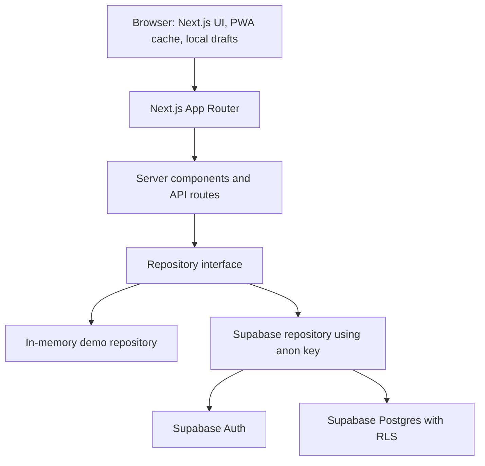

# OmoNETAB

**A Digital Bridge for Rural Entrepreneurs and Community Tourism in South Omo.**

OmoNETAB is a web marketplace prototype for presenting local products and services, helping potential customers discover offerings, and giving buyers and providers a place to coordinate through inquiries. It is designed for rural entrepreneurs, producers, artisans, community tourism providers, and visitors in South Omo, Ethiopia.

The project responds to challenges such as limited online discoverability, reliance on intermediaries, and difficulty comparing offering details or reaching potential customers. These are the problem areas the product is intended to address, not quantified impact claims. This repository contains no fieldwork report or independently verified research findings; validate assumptions with communities before treating them as observed facts.

> **Prototype status:** Demo mode is the out-of-the-box experience and uses illustrative sample records. No payment, SMS, or USSD transaction is performed. Supabase support is present in the code but has not been verified against a live project.

## The problem

Rural producers, artisans, self-help groups, and community tourism providers may have limited ways to publish offerings to people beyond their immediate networks. Potential customers may in turn lack clear information about availability, pricing units, provider details, and how to make contact. Connectivity, transport, trust, payment, and communication constraints can make these challenges harder.

These statements describe the project context and problem assumptions. The repository does not provide evidence that every challenge has been measured in South Omo or applies uniformly across communities. Local discovery, pricing practices, connectivity, logistics, and cultural protocols should be confirmed through community-led research and user testing.

## Our solution

OmoNETAB provides a digital catalogue where providers can publish product or service listings, describe terms such as price and availability, and receive inquiries. Listing categories represented in the prototype include handicrafts, textiles, honey and local foods, dairy and agricultural products, tourism experiences, guided visits, and craft demonstrations. These are supported listing types and illustrative demo categories—not confirmation that real offerings or community-approved experiences are currently available.

Cultural experiences should only be listed with informed community consent, community ownership of the description and imagery, and appropriate safeguards. OmoNETAB does not verify a cultural claim simply because a listing can be created.

## Target users

- **Rural entrepreneurs and local producers:** present goods, prices, quantities, and pickup preferences in one listing.
- **Artisans and self-help groups:** describe handmade products or coordinate contributions through the collective-opportunity workflow.
- **Community tourism providers and guides:** publish service listings with relevant details for visitors.
- **Domestic and international visitors, shops, and other buyers:** discover listings, compare their stated details, and send an inquiry.
- **Cooperatives and community organizations:** may be relevant partners for onboarding, consent, and coordination; no partnership is claimed by this repository.

The product is a prototype and these value propositions have not been established through reported outcome studies in this repository.

## Key features and implementation status

| Capability | Status | Scope and limits |
| --- | --- | --- |
| Marketplace discovery | **Implemented** | Browse product and service listings, search, filter, sort, and view listing details. Demo content is explicitly illustrative. |
| Provider profiles | **Implemented** | Public profiles and locally generated QR share codes; profile content still depends on the configured data source. |
| Provider registration and listing management | **Implemented** | Registration and seller dashboard workflows for profile and listing management, with protected server-side mutations. |
| Listing lifecycle and pictures | **Implemented** | Publish, unpublish, archive, restore, availability, and deletion only while no inquiry depends on the listing. Pictures are stored as a web address with a required alt description and a recorded consent statement; file upload needs object storage that is not configured. |
| Account help flows | **Implemented; real mail paths untested** | `/onboarding`, `/forgot-password`, `/reset-password`, `/verify-email`, and role-aware `/auth/callback`. In demo mode these pages explain that no mail service exists rather than presenting a form that could not work. |
| Buyer inquiries and arrangement status | **Implemented** | Buyers can submit inquiries; buyer and seller areas expose their records and status updates. Parties arrange payment and fulfilment themselves. |
| Buyer and seller dashboards | **Implemented** | Inquiries, order arrangements, profile/settings, and related records. These are not payment receipts or a payment ledger. |
| Collective opportunities | **Implemented** | Sample group opportunities, contributions, aggregation, and estimated shared transport costs. Estimates are not transport quotes. |
| Price calculator | **Implemented** | Cost, markup, and margin calculations; this is a planning aid, not price verification. |
| Contact and review workflows | **Implemented** | In-app message/review records depend on the configured repository. They do not imply email delivery or external moderation. |
| Administration | **Implemented, with demo limitations** | Admin screens and role-protected actions cover site settings, homepage content, listings, categories, messages, reports, reviews, and account roles. Demo-mode changes exist only in the in-memory store; some verification/report actions are explicitly simulated. |
| Offline support | **Implemented for reading, verified in a production build** | A service worker caches the app shell and the pages you browsed while it controlled the tab; a listing revisited without a connection still renders and its inquiry form still recalculates the subtotal. Listing drafts and queued inquiries are saved on-device. It is not a background-sync queue: nothing is sent to a server later that was not already waiting on the device. |
| Authentication and persistence | **Partially implemented** | Demo accounts use the demo session flow. Supabase Auth and the Postgres repository are implemented, but migrations and policies have not been verified against a live Supabase project. |
| PWA installation | **Partially implemented** | A web manifest and service worker are included; store distribution is not provided. |
| SMS, USSD, mobile money, and payment processing | **Planned / not implemented** | No gateway, payment provider, or transaction processing is included. |
| Local-language support | **Planned / incomplete** | English is the complete UI language. Other language options are not a substitute for translations reviewed by competent speakers. |
| Real-world verification and impact measurement | **Planned** | The prototype does not establish provider verification, field outcomes, or measured impact. |

## How it works

1. A provider registers and creates a profile, then drafts and publishes a product or service listing with its description, price unit, availability, and contact/pickup preferences.
2. A visitor or buyer browses or searches listings and reviews the provider and listing details.
3. The buyer submits an inquiry with the requested quantity and preferences. The application records an inquiry and reference; it does not charge the buyer.
4. The provider reviews the inquiry and records the next arrangement status. Buyer and provider coordinate pickup, delivery, dates, and payment outside the platform.
5. The parties can record completion or cancellation in the application. This status is not proof of a payment or an independently verified delivery.

The demo uses in-memory sample data. Persistent use requires a correctly configured Supabase project and successful verification of its schema, authentication, and access policies.

## Social impact and SDG alignment

OmoNETAB is intended to contribute to the following goals; these are project aims, not demonstrated or measured outcomes:

- **SDG 8 — Decent Work and Economic Growth:** support visibility and market-access opportunities for local entrepreneurs.
- **SDG 9 — Industry, Innovation and Infrastructure:** explore appropriate digital tools for underserved rural-market connections.
- **SDG 10 — Reduced Inequalities:** work toward reducing barriers to discovering and presenting local offerings.
- **SDG 11 — Sustainable Cities and Communities:** support responsible, community-led tourism where communities choose to participate.
- **SDG 12 — Responsible Consumption and Production:** make local offerings easier to discover and encourage accurate product information.

## Technology stack

- **Next.js 14** App Router and **React 18**
- **TypeScript**
- **Tailwind CSS**
- **Supabase JavaScript client and SSR helpers** for the optional Supabase data and authentication paths
- **`qrcode`** for locally generated QR images
- **Node.js** runtime and **npm** package manager (`package-lock.json`)
- **`tsx`** with Node's test runner for automated tests

No deployment provider is configured in this repository. The app uses Next.js build/start scripts and can be deployed to a compatible Node/Next.js host after its environment and data services are configured.

## Architecture



Main directories:

```text
src/
  app/                 App Router pages, layouts, and API routes
    admin/             Administration screens
    api/               Server-side application endpoints
    buyer/             Buyer account, inquiries, and arrangements
    dashboard/         Provider account and listing management
    listings/          Public listing details
    producers/         Public provider directory and profiles
  components/          Shared UI and feature components
  hooks/               Client-side hooks, including local listing drafts
  lib/                 Domain types, repositories, sessions, settings, and data access
    supabase/          Supabase client, row mappings, and repository
supabase/
  migrations/          Database schema and row-level security migrations
  seed.sql             Category seed data
public/                Static assets, web manifest, and service worker
tests/                 Node-based unit tests
  http/                Demo-mode HTTP verification suites (admin, buyer, producer)
```

## Installation and local development

Prerequisites: Node.js 18.17 or newer and npm. On Windows, use PowerShell; on macOS/Linux, use the equivalent shell commands.

```bash
git clone https://github.com/Newaznezif/OmoNetTab.git OmoNETAB
cd OmoNETAB
npm ci
```

Copy `.env.example` to `.env.local`. The defaults run the demo without external credentials. Then start the development server:

```bash
npm run dev
```

Open <http://localhost:3000>.

Available project scripts:

| Command | Purpose |
| --- | --- |
| `npm run dev` | Start the Next.js development server |
| `npm run build` | Create a production build |
| `npm run start` | Serve the production build |
| `npm run lint` | Run the configured Next.js ESLint check |
| `npm run typecheck` | Run TypeScript without emitting files |
| `npm test` | Run the Node test suite through `tsx` |

## Environment variables and Supabase

`.env.example` is the source of truth for supported variables:

| Variable | Purpose |
| --- | --- |
| `DATA_MODE` | `demo` (default) or `supabase`. Invalid/incomplete Supabase configuration fails rather than silently falling back to demo data. |
| `NEXT_PUBLIC_SITE_URL` | Base site URL used for generated links and QR codes. |
| `NEXT_PUBLIC_SUPABASE_URL` | Supabase project URL; required in Supabase mode. |
| `NEXT_PUBLIC_SUPABASE_ANON_KEY` | Supabase anon/public key; required in Supabase mode and subject to RLS. |

Never commit `.env.local`, credentials, or private keys. The application intentionally does not use a Supabase service-role key. Do not add one to client-visible configuration.

To use Supabase, provision a project, review all migrations in `supabase/migrations/`, configure Supabase Auth and its redirect URLs, then apply the migrations and category seed using the Supabase CLI/SQL tooling appropriate to your project. The migration sequence currently includes `0001_init.sql`, `0002_rls.sql`, `0003_admin_accounts_reviews.sql`, and `0004_inquiry_status_guard.sql`; `supabase/seed.sql` contains category seed data. Back up and review a database before applying schema changes.

Set `DATA_MODE=supabase`, `NEXT_PUBLIC_SUPABASE_URL`, and `NEXT_PUBLIC_SUPABASE_ANON_KEY` in `.env.local` and restart the application. **This integration has not been exercised against a live Supabase instance in this project.** Migrations and RLS policies are code, not evidence of a configured or verified deployment. Demo mode remains the verified local path.

## Handover: audit, permissions, verification, and setup

The five status words below are used with the meaning the brief gives them: **complete and verified**, **implemented but not tested**, **partially implemented**, **missing**, **blocked by credentials**. Anything claimed *verified* was executed on 2026-10-17 against a local dev server in `DATA_MODE=demo`. Nothing was executed against a live Supabase project — no project credentials were available in this environment, so every database-side behaviour is reviewed code, not observed behaviour.

### 1. Functionality that already worked, and was preserved

Before this pass the repository already had the public marketplace (home, explore, products, tourism, listing and producer pages, collective-order pages, pricing tool, contact, how-it-works, impact, offline, privacy, community guidelines), the inquiry record with reference and estimated subtotal, the seller dashboard basics, the admin area, collective selling read paths with contributions, the PWA service worker and on-device drafts, the demo session, and the Supabase repository plus migrations `0001`–`0003`. None of those routes were replaced, and no working feature was deleted to simplify the build.

Two removals were deliberate:

- `src/components/save-profile-button.tsx` was a second, unvalidated profile write path (it read DOM nodes by id and sent whatever it found). `/dashboard/profile` is now a read-only preview and every profile write goes through `AccountSettingsForm` → `POST /api/profile`, which is the one place that rejects a role, status, or verification sent by the browser.
- Nothing else. `/dashboard/listings/[id]` stays the listing edit screen, and the route named in the brief, `/dashboard/listings/[id]/edit`, is a redirect to it rather than a duplicate form.

### 2. Audit checklist

| Area | Status | What that means in this build |
| --- | --- | --- |
| Public pages, search, filters, listing and producer detail | **Complete and verified** (demo mode) | Every public route returns 200 and filters reduce the row set; unknown ids render the 404 page, not a blank one. |
| Buyer area: inquiries, orders, bookings, profile, settings | **Complete and verified** (demo mode) | 82 HTTP checks in `tests/http/buyer-smoke.mjs`. |
| Producer dashboard: listings, lifecycle, pictures, inquiries, orders, profile, settings | **Complete and verified** (demo mode) | 112 HTTP checks in `tests/http/producer-smoke.mjs`, including ownership refusals and suspension. |
| Coordinator collective selling: open, edit, status, contributions | **Complete and verified** (demo mode) | Same producer suite: oversell, non-member, fractional quantity, foreign write, withdrawal, fulfilled-cannot-reopen. |
| Admin area: users, roles, status, verification, listings, categories, homepage, settings, messages, reports, reviews, orders, opportunities, analytics, audit log | **Complete and verified** (demo mode) | 49 HTTP checks in `tests/http/admin-smoke.mjs`, including the last-active-administrator guards. |
| Demo authentication and session handling | **Complete and verified** | Sign-in, sign-out, role read-back per request, suspension taking effect immediately. |
| Real authentication: password sign-in, signup, email confirmation, recovery, onboarding | **Implemented but not tested** — **blocked by credentials** | `/sign-in`, `/register`, `/forgot-password`, `/reset-password`, `/verify-email`, `/onboarding`, `/auth/callback` exist and call the correct `@supabase/supabase-js` 2.118 methods; none of them could reach a project. |
| Administrative authorization model (no self-assignment, server-side checks) | **Complete and verified** (demo mode); **implemented but not tested** at database level | Registration can only produce `buyer` or `producer`; role/status/verification are re-read from the stored profile every request; `0003` triggers mirror the same rules in Postgres. |
| Schema, RLS policies, migrations | **Implemented but not tested** | `0001`–`0003` reviewed; `0004_inquiry_status_guard.sql` has never been applied anywhere, so its SQL is unverified. |
| Order/inquiry status rules and recomputed totals | **Complete and verified** (demo mode) | Amounts are computed server-side from the listing price at submission time; a buyer cannot record acceptance. |
| Offline support | **Complete and verified** (production build, browser-tested) | Shell plus browsed pages served from cache with the origin unreachable; on-device listing drafts, a per-listing queued inquiry that keeps its reference across a reload, and duplicate-submit refusals. No background sync queue, and no claim that an offline write reaches a server later. |
| Accessibility | **Partially implemented** | Landmarks, skip link, labelled fields, `role=status`/`role=alert` feedback, and a required alt description for every new picture are verified; no formal audit (no screen-reader or keyboard sweep) was performed. |
| Languages | **Partially implemented** | English is complete. Amharic is a partial, review-pending draft. Hamer, Dasenech and Tsamai are **missing** — deliberately, because no competent-speaker review exists. |
| Payments, SMS, USSD, mobile money, telecom | **Missing** | Nothing in this build moves money or sends a message, and no screen claims otherwise. |
| Object storage for uploaded files | **Missing** | Listings therefore store a web address per picture; see the limitation note below. |

### 3. Pages and routes

59 pages, 27 route handlers, 4 layouts. New in this pass (committed as `72644b5`, plus the offline work committed after it):

```text
/forgot-password            /reset-password           /verify-email
/onboarding                 /dashboard/settings       /dashboard/orders
/dashboard/listings/[id]/edit   (alias → /dashboard/listings/[id])
/dashboard/inquiries/[id]   /dashboard/collective-orders/new
/dashboard/collective-orders/[id]
POST/PATCH /api/collective/opportunities
PATCH    /api/collective/opportunities/[id]
PATCH    /api/collective/contributions/[id]
DELETE   /api/listings/[id]
```

Existing areas kept: `/admin` and its 15 sub-pages, `/buyer` and its 6 sub-pages, `/dashboard` and its listing/inquiry pages, the public catalogue, `/api/inquiries`, `/api/listings`, `/api/profile`, `/api/session`, `/api/contact`, `/api/reviews`, `/api/reports`, and the `/api/admin/*` form endpoints. `GET /buyer/dashboard` does not exist — the buyer area is served under `/buyer`, as the brief allows when an app already has its own routing pattern.

### 4. Role-permission matrix

Enforced in `requireRole()`/`requireArea()` and again inside the repository; in Supabase mode the same rules are restated as RLS policies. A suspended account keeps read access to its own records and loses every write path, immediately, because role and status are read from the stored profile on each request.

| Capability | Visitor | Buyer (tourist / customer) | Producer | Coordinator | Administrator |
| --- | --- | --- | --- | --- | --- |
| Browse and search the marketplace | ✓ | ✓ | ✓ | ✓ | ✓ |
| Send an inquiry or booking | ✓ as a guest (name + contact supplied) | ✓ | ✓ | ✓ | ✓ |
| Open `/buyer` (their own arrangements) | — | ✓ | ✗ | ✗ | ✗ |
| Create, edit, publish, archive, delete-when-safe **their own** listings | ✗ | ✗ | ✓ | ✓ | ✗ (own listings only) |
| Manage any listing, hide or feature one | ✗ | ✗ | ✗ | ✗ | ✓ |
| Move the seller-side status of an inquiry on their own listing | ✗ | ✗ | ✓ | ✓ | ✓ |
| Move the buyer-side status (confirm, cancel) of their own request | guest ✗ | ✓ | ✓ (on requests they sent) | ✓ | ✓ |
| Record acceptance | ✗ | ✗ (server refuses) | ✓ | ✓ | ✓ |
| Open or steer a collective opportunity | ✗ | ✗ | ✗ | ✓ (their own orders) | ✓ |
| Confirm or withdraw a contribution | ✗ | ✗ | Own contribution: withdraw only | ✓ (as that order's coordinator) | ✓ |
| Approve a verification application | ✗ | ✗ | ✗ (never their own) | ✗ | ✓ |
| Assign or remove roles, suspend or reactivate accounts | ✗ | ✗ | ✗ | ✗ | ✓ (and never the last active admin) |
| Edit site settings, homepage content, categories | ✗ | ✗ | ✗ | ✗ | ✓ |
| Read analytics and the audit log | ✗ | ✗ | ✗ | ✗ | ✓ |
| Edit their own profile fields | ✗ | ✓ | ✓ | ✓ | ✓ |
| Set their own role, status or verification | ✗ | ✗ | ✗ | ✗ | ✗ (only another admin can) |

A producer who sends an inquiry cannot open `/buyer` to watch it, because that area is limited to the buyer role; the record is still visible to the seller. That is a known scope limitation, noted below.

### 5. Features completed in this pass

- Listing lifecycle: publish, unpublish, archive, restore (publishing clears the archived flag), availability toggle, and delete that the repository refuses while an inquiry still points at the listing — with the refusal stated in the UI before anyone clicks it.
- Listing pictures: attach by web address with a required alt description and a consent statement, remove one while the rest are kept exactly as stored, a buyer-side gallery on the listing page, and server-side rejection of non-`http(s)` addresses, missing descriptions and missing consent.
- One profile write path: `AccountSettingsForm` (seller and buyer variants), a read-only `/dashboard/profile`, and `/dashboard/settings` and `/buyer/settings` for account changes.
- Auth surface: `/onboarding` that branches by account type and derives the role server-side, `/forgot-password`, `/reset-password`, `/verify-email`, and `/auth/callback` that lands each role in its own area, refuses a `?next=` outside its allowlist, and sends a suspended account to the refusal page. In demo mode these pages explain that no mail service exists instead of showing a form that would lie.
- Coordinator tooling: create and edit a collective opportunity, the five opportunity states with the fulfilled one irreversible, contribution confirmation, withdrawal and quantity correction, all with ownership checks and stock-based oversell protection.
- Producer order board at `/dashboard/orders`: goods and sessions separated, an honest sum-of-estimates line, and the closed records listed rather than merely counted.
- Inquiry filtering by listing and status that actually reduces the rows, with visible chips for each filter.
- Admin enforcement details: role assignment requires confirmation, the last active administrator cannot be demoted or suspended, and audit entries carry summaries only.
- Offline path repaired: the worker is now valid browser JavaScript (it had never once installed), registers on a page that already finished loading, precaches the shell without letting one failing route empty the cache, keeps pages network-first so an online buyer never sees a stale price, and falls back to the `/offline` explainer. A queued inquiry is stored per listing, keeps its reference across a reload, restores its fields, and clears when the server accepts it. Creating a listing while offline now says it needs a connection instead of firing a doomed request, and three submit attempts create one listing rather than three.

### 6. Incomplete, blocked, or missing

- **Blocked by credentials:** applying `0001`–`0004` to a live project, verifying every RLS policy with a second tenant, and exercising real sign-in, email confirmation, and password recovery. This is the single biggest open item; see section 11.
- **Partially implemented:** Amharic (draft strings only), reviews and verification (records exist; nothing verifies a real person). Offline reading is verified; offline *writes* stop at the device — a queued inquiry waits for you to press send again rather than being delivered by a background worker.
- **Missing by decision:** payment, SMS, USSD, and any telecom path; object storage for uploaded files; a self-service account deletion (the other party's inquiry is their evidence, so removal is an administrator action); a buyer area for sellers who buy.
- **Not performed:** a formal accessibility audit, load testing, browser matrix testing, and a security review by a third party.

### 7. Database migrations

| File | State | Purpose |
| --- | --- | --- |
| `supabase/migrations/0001_init.sql` | Reviewed, **not applied** | Core tables: profiles, categories, listings, `listing_images`, inquiries, groups, opportunities, contributions, reviews, messages, reports. |
| `supabase/migrations/0002_rls.sql` | Reviewed, **not applied** | RLS enabled on every exposed table; `current_profile_id()`, `is_admin()`, `in_group()` are `SECURITY DEFINER` on purpose — a policy that read `profiles` directly would recurse into its own policy. They return values derived from `auth.uid()` only, so they describe the caller rather than widen access. |
| `supabase/migrations/0003_admin_accounts_reviews.sql` | Reviewed, **not applied** | Account kinds, site settings row, audit log, privileged-column triggers, and the insert guard that stops a signup from creating an administrator or coordinator. |
| `supabase/migrations/0004_inquiry_status_guard.sql` | **Written this pass, never applied or executed anywhere** | Stops a buyer from rewriting quantity or the recorded totals through the anon key, and restricts each side to the statuses it can honestly attest to. |
| `supabase/seed.sql` | Categories only | No listings, prices, or identities are seeded as if real. |

Apply them in order `0001` → `0002` → `0003` → `0004`. They assume an empty schema; do not run them against a database that already holds data without reading them first.

**Do not set `DATA_MODE=supabase` against a database that has only `0001` and `0002`.** `0002_rls.sql` gives every signed-in user a `for all` policy on their own `profiles` row, which in that state lets a normal account `update public.profiles set role = 'admin'` and hand itself the administrator seat; `0003` is the migration that closes it with the `profiles_privileged_columns` trigger and `guard_admin_insert`. The same `0002` policies also leave contact details and group membership readable (`"Public profiles are readable" … using (true)`, `"Members readable" … using (true)`), which `0003` narrows only partially. Because none of these files have been executed anywhere, treat the sequencing above as unverified until it is applied to a throwaway project and tested with a second, non-administrator account.

### 8. Environment variables

See `.env.example`; there are no secret values in this repository and none should be added.

| Variable | Required | Purpose |
| --- | --- | --- |
| `DATA_MODE` | yes (`demo` default) | `demo` or `supabase`. An incomplete Supabase configuration refuses the first data-touching request rather than falling back to sample data; it does not stop the server from booting. |
| `NEXT_PUBLIC_SITE_URL` | yes, for any real deployment | The origin written into account-confirmation and password-reset **links**, plus share links and QR codes. Sign-in, sign-out and `/auth/callback` no longer use it (they redirect relatively), but an emailed link built without this value points at `localhost:3000` and cannot be opened by anyone else. |
| `NEXT_PUBLIC_SUPABASE_URL` | in Supabase mode | Project URL. |
| `NEXT_PUBLIC_SUPABASE_ANON_KEY` | in Supabase mode | Public key; every read and write it makes is still subject to RLS. |
| `SUPABASE_SERVICE_ROLE_KEY` | **never** | The application does not read it, by design: it bypasses RLS and has no place in a request path a browser can influence. |

`.gitignore` excludes `.env`, `.env.local`, key material, and credential files. Confirm with `git status --porcelain` before every commit.

### 9. Tests actually run, and their results

All commands were run on 2026-10-17 and re-run on 2026-10-18 (section 9.1) on Windows. The HTTP suites were run against `next start` serving the production build on a local port (earlier runs used `next dev`); they are parameterised by `SMOKE_BASE`. Each suite needs a freshly started server because it mutates the in-memory demo store.

| Command | Result |
| --- | --- |
| `npm test` | **46 passed, 0 failed** — pricing, money, mappers, inquiry idempotency, demo auth, repository rules. |
| `npx tsc --noEmit` | Clean. |
| `npx next lint --quiet` | Clean. |
| `node tests/http/admin-smoke.mjs` | **49/49 PASS** — administrator surface, refusals for non-admins, last-admin guards, public page renders, 404 page. |
| `node tests/http/buyer-smoke.mjs` | **82/82 PASS** — buyer area access, guest inquiry, buyer-side statuses, suspension matrix, role-escalation attempts. |
| `node tests/http/producer-smoke.mjs` | **112/112 PASS** — every selling route, listing ownership matrix, lifecycle, pictures, inquiry loop, delete guard, profile/settings, coordinator and contribution rules, suspension matrix, demo-mode honesty of the auth help pages, 404s. |
| `node tests/http/workflow-smoke.mjs` | **20/20 PASS** — the admin-to-public workflow as one repeatable suite: category created, read back through the public filter, listing created unpublished (public 404, inquiry refused), published, rendered with the stored price, guest inquiry accepted, edited, price change visible publicly, unpublished again, foreign producer 403, anonymous 401, category deactivated and still protected from deletion, record still owned by its producer. |
| `npm run build` | **Succeeded** (see section 10). |

Manual browser checks on the production build, in a real browser tab at a 510px viewport:

| Check | Result |
| --- | --- |
| Worker installs by itself on an ordinary page load | **PASS** — registration reached `activated`, cache `omonetab-shell-v2` held the 8 shell routes. |
| Origin unreachable, revisit a page loaded while controlled | **PASS** — `/listings/lst_forest_honey` rendered from cache (title, 68.00 ETB price) and the inquiry form still worked: quantity 8 recomputed the subtotal to 544.00 ETB. |
| Origin unreachable, route never loaded while controlled | **PARTIAL** — the cached HTML can arrive without its JS chunks, and React then replaces the page with its client-exception message. Serving the `/offline` explainer instead requires knowing which chunks each page needs; not implemented. |
| Queued inquiry survives a reload | **PASS** — the saved name, contact, quantity, message, and date were restored, the outgoing request reused the stored reference `idem_seed_verify_001`, and the device record cleared once the server accepted it. |
| Duplicate submission refusal | **PASS** — three submit attempts fired back to back on the new-listing form created **one** listing (2 → 3 records). Before this pass the same sequence created three. |
| Offline indicator on a phone-width screen | **PASS** — the offline chip computes to a visible `flex` at 510px; the online chip stays desktop-only by design. |
| Real airplane-mode / interface-down offline state | **NOT TESTED** — the tooling available cannot switch the device network off; `navigator.onLine` was simulated, and `onLine` stays true when only the origin is down. |

Notes on how to read those numbers:

- The HTTP suites run against **demo mode**. They prove the application's own authorization layer refuses correctly; they cannot prove RLS refuses the same way, because demo mode has no Postgres underneath.
- Each suite mutates the in-memory store (it deletes listings, suspends accounts, changes roles), so run one suite per freshly started server. Running two against the same process produces failures that belong to the leftover state, not to the code.
- **Not tested:** everything requiring a live Supabase project — RLS policy outcomes, migration application, `SECURITY DEFINER` behaviour, real password reset email, email confirmation, magic-link exchange in `/auth/callback`, and the onboarding path behind real auth. Those are marked accordingly above rather than counted as passes.

### 9.1 Stabilization audit (2026-10-18)

The whole tree, both repositories, the migrations and the deployment surface were re-inspected and the checks above were re-run on the current commit. Everything listed here is an observed result, with the command that produced it.

Re-run results: `npx tsc --noEmit` clean; `npx next lint` **1 warning, 0 errors** (the deliberate `` in `src/components/listing-images.tsx` — producer pictures are external links and cannot go through `next/image` without a configured image domain); `npx next lint --quiet` clean; `npm test` **46/46**; `npm run build` exit **0**; `node tests/http/admin-smoke.mjs` **49/49**, `buyer-smoke.mjs` **82/82**, `producer-smoke.mjs` **112/112**, `workflow-smoke.mjs` **20/20**, each on its own freshly started `next start` process.

The admin-to-public workflow was traced over HTTP rather than read in the source, and is now a permanent suite: `tests/http/workflow-smoke.mjs`. It covers administrator creates a category → it appears in the public category filter → producer creates a listing in it **unpublished** → public page 404s → publishing makes it render with the stored price → an inquiry is accepted → the title and price edit propagate to the public page → unpublishing 404s again → a second producer and an anonymous caller are refused (403/401) → deactivating the category removes it from browsing while the listing record survives for its owner → deleting it is refused while a listing still uses it. **20 checks, 20 passed.** It mutates the demo store, so it needs its own freshly started server like the other three suites.

Fixed in this pass, each followed by the full check set above:

- **Demo mode accepted an inquiry on an unpublished listing.** `src/lib/supabase/repository.ts` refused it (`This listing is not published.`) and `src/lib/demo-repo.ts` did not, so the two modes answered the same request differently. The check is now in both, and the workflow trace above proves the demo refusal.
- **Signing out, and `/auth/callback` and the Supabase sign-in redirect, pointed at `http://localhost:3000`** whenever `NEXT_PUBLIC_SITE_URL` was unset — correct in development, broken for a visitor on a deployed host. All three now reply with a **relative** `Location`, which the browser resolves against the site it is already on. Falling back to the request's own origin was tried first and rejected: inside a route handler `req.url` reports the address `next start` bound itself to, not the address the visitor used, so it returned `http://localhost:3000/` even when the request arrived with `Host: omotab.example.com`. Verified after the change: sign-out returns `Location: /` and `/auth/callback` returns `Location: /sign-in?error=missing_code` under that same foreign Host header, and following the redirect resolves to the site actually being served. The confirmation and password-reset **links mailed to users** are still built from `NEXT_PUBLIC_SITE_URL` (they must be absolute, and they are composed inside server actions) — see section 13.
- **`.env.example` and the README said an incomplete Supabase configuration "fails at startup".** It does not: `requireSupabaseConfig()` runs when the Supabase client is built, which is per request. A misconfigured deployment boots cleanly and then errors on the first page that reads data. The wording now says what happens.

Public pages are not hardcoded. `src/app/page.tsx`, `/products`, `/tourism`, `/listings/[id]` and `/producers/[id]` each call `getRepo()` per request, and no page or component imports the seed module (`src/lib/demo-data.ts` is reachable only through the demo repository and the reset helper). The workflow suite proves it from the outside: a record created through the API becomes visible on the public page, changes there when edited, and disappears when unpublished — which mock markup could not do.

Left open on purpose, because each needs a live Supabase project or a decision rather than a local edit:

- `0002_rls.sql` keeps `"Public profiles are readable" … using (true)` and `"Members readable" … using (true)`, so anyone with the anon key can read profile rows and group membership. `0003` narrows the profile policy but nothing narrows `group_members`. Writing another migration that cannot be executed against a real project would replace a known gap with an unverified claim.
- Postgres enforces `listings.category_id references categories(id) on delete restrict`; demo mode stores any string. A typo'd or stale category id therefore fails loudly in Supabase mode and silently in demo mode.
- `DATA_MODE` is parsed in two places (`getDataMode()` in `src/lib/supabase/config.ts` and `isDemoMode()` in `src/lib/store.ts`). They agree today; they are two chances to disagree later.
- Inquiry, contact, report and review endpoints have no rate limit, and consent statements and picture links are recorded rather than verified (section 14).

### 10. Production build status

`npm run build` completed successfully with the current tree: 59 pages and 27 route handlers compiled, no type or lint errors, and every data-bearing route emitted as dynamic (`ƒ`) because both repositories read per request. `npm run start` then serves that build. The build was produced from a clean `.next` directory (`rm -rf .next` first) on 2026-10-17 and again on 2026-10-18 after the audit fixes; both exited 0. `npx next lint` without `--quiet` reports one warning and no errors: the deliberate `` in `src/components/listing-images.tsx`, which stays a plain tag because producer pictures are external links that `next/image` cannot optimize without a configured domain.

### 11. Setting up the first administrator, securely

There is no public endpoint that grants administrator access, in either mode. `roleForNewAccount()` maps registration to `buyer` or `producer` only, the profile route overwrites any role the browser sends, and in Supabase mode `profiles_privileged_columns` and `profiles_guard_admin_insert` refuse a privileged write from a caller who is not already an administrator.

**Demo mode.** Nothing to provision: the sample reviewer account on `/sign-in` already has `role = 'admin'`. It is sample data, not a credential, and it resets when the server restarts.

**Supabase mode, first administrator only.** After the account has registered normally through `/register` → `/onboarding` (so `auth.users` holds a real identity with a password the person chose), run this in the Supabase SQL editor while signed in as the project owner. It is one transaction, one row, and the guard is restored inside the same transaction:

```sql
begin;

-- 'you@example.com' is the address the intended administrator signed up with.
create temp table _first_admin on commit drop as
  select id from public.profiles
  where user_id = (select id from auth.users where email = 'you@example.com');

alter table public.profiles disable trigger profiles_privileged_columns;
alter table public.profiles disable trigger profiles_guard_admin_insert;

update public.profiles
   set role = 'admin', account_kind = 'platform_admin'
 where id = (select id from _first_admin);

alter table public.profiles enable trigger profiles_privileged_columns;
alter table public.profiles enable trigger profiles_guard_admin_insert;

commit;
```

Then:

1. Verify the row and confirm RLS is still on: `select role, account_kind, status from public.profiles where id = (select id from public.profiles where role = 'admin');` and `select relrowsecurity from pg_class where relname = 'profiles';` must return `true`.
2. Sign in as that account and confirm `/admin` renders for it, and that a producer account is still refused at `/api/admin/roles`.
3. From now on, promote every further administrator through **Admin → Roles** with the confirmation step. Do not repeat the SQL above; the triggers are the protection against a self-promotion, and leaving them disabled is a regression in the security model.
4. Keep at least two active administrators. The application refuses to demote or suspend the last active one, which is also why step 3 matters before anyone leaves the project.
5. Provisioning should happen before the registration page is reachable to the public, or with `DATA_MODE=supabase` on a private preview URL. If the database is already open to signups, someone could take the administrator seat first; the triggers stop them from being handed it, but they do not stop a race for the SQL step.

A `service_role` key is not needed for any of this, and the application is written so that it never reads one.

### 12. Running locally

```bash
npm ci
cp .env.example .env.local      # defaults to DATA_MODE=demo, no credentials needed
npm run dev                     # http://localhost:3000
npm run typecheck && npm run lint && npm test
```

To reproduce the HTTP verification, start a **fresh** dev server in one terminal and run one suite per server start, in another:

```bash
npm run dev                                  # leave this running
SMOKE_BASE=http://localhost:3000 node tests/http/admin-smoke.mjs
```

Then stop the server, start it again, and run `tests/http/buyer-smoke.mjs`; repeat for `tests/http/producer-smoke.mjs` and `tests/http/workflow-smoke.mjs`. On Windows, set the variable for one command with `$env:SMOKE_BASE="http://localhost:3000"; node tests/http/admin-smoke.mjs`.

### 13. Deployment

1. Deploy to any Node 18.17+ host that runs `npm run build` and `npm run start` (Vercel, a container, or a plain Node host). No provider is configured in this repository, and nothing has been deployed from it.
2. Apply **all four** migrations in order (section 7), seed categories, and provision the first administrator (section 11) **before** switching the application to the database. `DATA_MODE=supabase` is the last value you set, not the second: a project holding only `0001` and `0002` still lets a signed-in account promote itself to administrator through its own profile row.
3. Set `NEXT_PUBLIC_SITE_URL` to the public origin, then `DATA_MODE=supabase` with the project URL and anon key. `NEXT_PUBLIC_SITE_URL` is not optional once real accounts exist: the confirmation and password-reset links are built from it, and unset it emails a link to `localhost:3000`. `NEXT_PUBLIC_*` values are read at build time, so a host that injects them at runtime still needs a rebuild.
4. In the Supabase dashboard, add the deployed origin to the allowed redirect URLs for email confirmation and password recovery. `/auth/callback` redirects on relative paths, so it returns the visitor to whichever origin they arrived on; the only absolute address it depends on is the `emailRedirectTo` built during registration (step 3). It accepts a `?next=` only under `/dashboard`, `/admin`, or `/buyer`.
5. Confirm after deployment that `/api/session` refuses demo sign-in (it returns 400 when `DATA_MODE=supabase`), that a suspended account loses write access, and that no `SUPABASE_SERVICE_ROLE_KEY` exists in the host's environment.
6. Until step 2 has actually been performed by someone with credentials, treat any deployed instance as demo data — the README status line at the top should be updated only when it is not.

**On Vercel specifically.** Nothing is configured for it in this repository: there is no `vercel.json`, no `.github/workflows`, and no project has ever been deployed from here, so all of the following is a checklist, not a verified deployment. Vercel detects Next.js 14 automatically and needs no override for build (`npm run build`), output (`.next`) or start. Set `DATA_MODE`, `NEXT_PUBLIC_SUPABASE_URL`, `NEXT_PUBLIC_SUPABASE_ANON_KEY` and `NEXT_PUBLIC_SITE_URL` as environment variables **for the Production environment before the first build**, because `NEXT_PUBLIC_*` is inlined at build time and changing one later requires a redeploy. Never add `SUPABASE_SERVICE_ROLE_KEY` — the application does not read it, and its presence on the host is an accident waiting to happen. Then add both `https://<project>.vercel.app` and the production domain (if any) to Supabase Auth's redirect Allow list, and set SMTP before enabling email confirmation or password recovery; without SMTP those two flows cannot complete, and the pages already say so in demo mode. There is no object storage configured, so pictures stay external links and `public/sw.js` caching is the only asset cache in play. `package.json` declares no `engines` field; the build was produced on Node 24 locally, so pin a version on the host rather than assuming Vercel's default matches.

### 14. Known security and integration limitations

- **Demo session is not authentication.** In `DATA_MODE=demo` the session cookie is a plain JSON `{userId}` with no signature. Carrying a role is impossible, but anyone who can set that cookie can act as that sample account. It is acceptable only because demo mode holds throwaway sample records and no real data — which is why the brief's "do not pretend demo mode is production authentication" is honoured by labelling rather than by treating it as a security boundary.
- **RLS is unverified.** The policies and triggers are reviewed code, never executed. A live test must attempt the same refusals the HTTP suites made, directly against Postgres with the anon key.
- **No rate limiting or abuse controls** on inquiry, contact, report, or review endpoints; a guest can submit repeatedly.
- **Picture addresses are stored as supplied.** New entries must be `http(s)`, and every `` renders the producer's own link, so a listing can point at a host that later changes the picture or logs the viewer. Nothing fetches or verifies the image.
- **Consent statements are recorded, not verified**, including for cultural imagery; the community-guidelines page is a draft awaiting review with community partners.
- **Estimated totals are estimates.** They are computed from the listing price at submission time and never represent money owed, held, or paid.
- **Email delivery is untested** — password recovery and confirmation depend on a configured SMTP/provider inside Supabase Auth; in demo mode those pages state plainly that no mail service exists.
- **No account deletion self-service**, no data-export path, and no retention policy yet; the privacy page is a placeholder that must be finalised with legal review before real data.
- **Two names for one product are still in the tree.** The interface, manifest, and this README call it **OmoNETAB**, while some internal identifiers (`omolink_demo_session`, the migration comments) and the site-settings row that `0003` seeds (`siteName: "OmoLink"`) say **OmoLink**. Nothing breaks — an administrator can change the displayed name under **Admin → Site settings** — but settle on one name before a real pilot, because a database created from `0003` will show a different brand than the code defaults do.

- **Offline reading works for pages you actually browsed.** The service worker registers only in a production build (development bundle URLs keep their name while their contents change, so caching them would hide new code). A page loaded while the worker controlled the tab is readable and interactive afterwards without a network. A page whose HTML was precached but never browsed that way can arrive without the JavaScript chunks it needs, and React then shows its client-exception message instead of the cached text; the fix would be a per-page chunk manifest, which is not implemented. See the browser table in section 9.
- **`navigator.onLine` is weaker than it looks.** It means the device has a network interface, not that OmoNETAB can be reached. With the origin down but Wi-Fi up, the header chip still reads "Online" even though the app is serving from cache.
- **Local queues are device-local and unencrypted.** Queued inquiries and listing drafts sit in `localStorage`/IndexedDB for whoever holds that phone, and clearing site data deletes them. They are not delivered to anybody until the buyer presses send again with a connection.

### 15. Three-minute demonstration script

Run in demo mode (`npm run dev`), which resets on restart, so it can be shown repeatedly. For step 7 only, use `npm run build && npm start` instead — the offline worker deliberately does not register in development.

1. **Public side, signed out** — `/` → open a basket listing → show the labelled sample placeholder, the unit price in ETB, and the note that no payment moves. Send an inquiry for 3 bundles as a guest and point at the reference number.
2. **Seller side** — sign in as the basket producer → `/dashboard/orders` shows it under "Goods to supply", `/dashboard/inquiries` filters by listing → accept it, move it to "Fulfillment arranged", and note that the status says nothing was delivered yet.
3. **Listing control** — `/dashboard/listings` → unpublish, show the public page refusing with a 404, republish → attach a picture, show that the alt description and consent statement are required → archive.
4. **Buyer side** — sign in as the hotel account → `/buyer/orders` shows the same record from the other side, with the buyer's own confirm/cancel actions and the same "not a receipt" wording.
5. **Group selling** — sign in as the coordinator account → open a collective opportunity, watch contributions aggregate toward the target, confirm one contribution, and show that withdrawing it recomputes the total. Show the transport figure labelled as an estimate.
6. **Administration** — sign in as the reviewer → `/admin/users` suspend the buyer account → show, in the buyer's own tab, that reads still work but every write is refused → reactivate. Try to promote an account without the confirmation checkbox, then attempt to demote the last administrator and show the refusal.
7. **Low connectivity** — on the production build, open a listing, then stop the server (or turn the device off the network) and revisit that same listing: it still renders, and changing the quantity still recomputes the subtotal, from the cache. Then visit a page you never opened and show the `/offline` explainer, plus the draft picker and the queued-inquiry notice. Say plainly what is not real: no payment, no SMS, no verified producers, no live database yet, and an offline write waits on the phone until someone sends it.

## Project status and roadmap


The repository contains a navigable marketplace prototype, demo-backed buyer/provider/admin workflows, and an optional Supabase integration that still requires live validation. Sample identities, listings, prices, locations, and activity are illustrative only.

Proposed next steps:

- Validate onboarding, product information, pricing, and inquiry workflows with local entrepreneurs and visitors.
- Agree community-led consent, profile verification, moderation, privacy, and cultural-representation practices before publishing real information.
- Configure and security-test Supabase Auth, migrations, RLS, backups, and operational monitoring.
- Test usability and resilient low-connectivity behavior on target devices and networks.
- Explore reviewed local-language interfaces and appropriate SMS/USSD options if communities request them.
- Evaluate logistics and digital-payment integrations only with local partners, legal review, and a tested provider.
- Replace sample data and placeholders with verified content only after receiving permission.

## Security, privacy, and responsible cultural representation

- Use server-side role and ownership checks; do not rely on hidden UI controls as authorization.
- Supabase access is intended to use the anon key with Row Level Security. The policies have not been tested on a live database.
- Keep secrets out of source control, use `.env.local` for local settings, and never expose service-role credentials in browser code.
- Validate application data and review the privacy and security design before handling real user information.
- The privacy and community-guidelines pages are drafts/placeholders, not legal advice or evidence of community approval.
- Obtain informed permission before publishing identifiable people, photographs, cultural knowledge, rituals, or community-owned descriptions. Respect requests to withdraw or correct content.
- Do not present illustrative profiles, locations, verification labels, prices, reviews, or impact figures as real-world evidence.

## Contributing, license, and contact

Contributions should be made through a focused branch and pull request. Include a clear description, explain user-visible changes, and run the relevant checks (`npm test`, `npm run typecheck`, `npm run lint`, and `npm run build`) before requesting review. Do not include real personal data or credentials in commits, tests, or screenshots.

No `LICENSE` file is present in this repository. All rights and reuse permissions are therefore unspecified here; do not assume the project is open source or add a license without the maintainers' decision.

Repository: <https://github.com/Newaznezif/OmoNetTab>. No public contact address or organizational partnership is asserted by this README.
